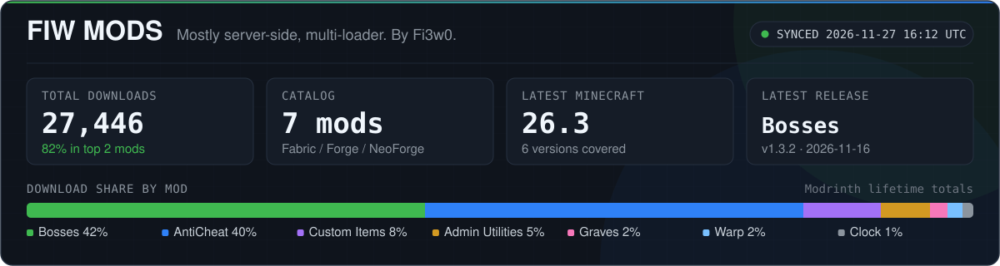

# FIW Mods

Minecraft mods by [Fi3w0](https://github.com/Fi3w0), mostly server-side. Downloads, versions and supported loaders refresh daily from Modrinth; report bugs on each mod's own repo.

<!-- stats:start -->

## Mods

**27,351 downloads** · **7 mods** · Fabric / Forge / NeoForge · latest **Minecraft 26.3**

<table>
<tr>
<td width="50%" valign="top">
<strong><a href="https://modrinth.com/mod/fiw-bosses">FIW Bosses</a></strong> 
<a href="https://modrinth.com/mod/fiw-bosses"><strong>11,501</strong></a> downloads · <a href="https://modrinth.com/mod/fiw-bosses/version/n2MiZZJr"><code>v1.3.2</code></a>
  
JSON boss framework 
Updated 10d ago · MC 1.20.1 to 26.3 (6 versions) 
Fabric · Forge · NeoForge 
<a href="https://modrinth.com/mod/fiw-bosses">Modrinth</a> · <a href="https://github.com/Fi3w0/Fiw-Bosses">GitHub</a>
</td>
<td width="50%" valign="top">
<strong><a href="https://modrinth.com/mod/fiw-anticheat">FIW AntiCheat</a></strong> 
<a href="https://modrinth.com/mod/fiw-anticheat"><strong>10,943</strong></a> downloads · <a href="https://modrinth.com/mod/fiw-anticheat/version/E52P2uyA"><code>v2.2.1</code></a>
  
Mod verification and anti-cheat 
Updated 10d ago · MC 1.20.1 to 26.3 (6 versions) 
Fabric · Forge · NeoForge 
<a href="https://modrinth.com/mod/fiw-anticheat">Modrinth</a> · <a href="https://github.com/Fi3w0/Fiw-Anticheat">GitHub</a>
</td>
</tr>
<tr>
<td width="50%" valign="top">
<strong><a href="https://modrinth.com/mod/fiw-custom-items">FIW Custom Items</a></strong> 
<a href="https://modrinth.com/mod/fiw-custom-items"><strong>2,256</strong></a> downloads · <a href="https://modrinth.com/mod/fiw-custom-items/version/pDTNiBPa"><code>v1.3.4</code></a>
  
JSON custom items and abilities 
Updated 10d ago · MC 1.21.1 to 26.3 (5 versions) 
Fabric · NeoForge 
<a href="https://modrinth.com/mod/fiw-custom-items">Modrinth</a> · <a href="https://github.com/Fi3w0/Fiw-Tools">GitHub</a>
</td>
<td width="50%" valign="top">
<strong><a href="https://modrinth.com/mod/fiw-admin-utilitys">FIW Admin Utilities</a></strong> 
<a href="https://modrinth.com/mod/fiw-admin-utilitys"><strong>1,408</strong></a> downloads · <a href="https://modrinth.com/mod/fiw-admin-utilitys/version/o2ryrI4G"><code>v1.4.0</code></a>
  
Maintenance and moderation tools 
Updated 10d ago · MC 1.20.1 to 26.3 (6 versions) 
Fabric · Forge · NeoForge 
<a href="https://modrinth.com/mod/fiw-admin-utilitys">Modrinth</a> · <a href="https://github.com/Fi3w0/fiw-admin-utilitys">GitHub</a>
</td>
</tr>
<tr>
<td width="50%" valign="top">
<strong><a href="https://modrinth.com/mod/fiw-graves">FIW Graves</a></strong> 
<a href="https://modrinth.com/mod/fiw-graves"><strong>505</strong></a> downloads · <a href="https://modrinth.com/mod/fiw-graves/version/V9qEec5s"><code>v1.3.0</code></a>
  
Death chests and loot backup 
Updated 10d ago · MC 1.20.1 to 26.3 (6 versions) 
Fabric · Forge · NeoForge 
<a href="https://modrinth.com/mod/fiw-graves">Modrinth</a> · <a href="https://github.com/Fi3w0/Fiw-Graves">GitHub</a>
</td>
<td width="50%" valign="top">
<strong><a href="https://modrinth.com/mod/fiw-warp">FIW Warp</a></strong> 
<a href="https://modrinth.com/mod/fiw-warp"><strong>430</strong></a> downloads · <a href="https://modrinth.com/mod/fiw-warp/version/QvlAGj6n"><code>v1.2.0</code></a>
  
Homes, warps and back teleport 
Updated 10d ago · MC 1.20.1 to 26.3 (6 versions) 
Fabric · Forge · NeoForge 
<a href="https://modrinth.com/mod/fiw-warp">Modrinth</a> · <a href="https://github.com/Fi3w0/Fiw-Warp">GitHub</a>
</td>
</tr>
<tr>
<td width="50%" valign="top">
<strong><a href="https://modrinth.com/mod/fiw-clock">FIW Clock</a></strong> 
<a href="https://modrinth.com/mod/fiw-clock"><strong>308</strong></a> downloads · <a href="https://modrinth.com/mod/fiw-clock/version/hsrHwFe7"><code>v1.2.0</code></a>
  
Playtime, kills and deaths 
Updated 10d ago · MC 1.20.1 to 26.3 (6 versions) 
Fabric · Forge · NeoForge 
<a href="https://modrinth.com/mod/fiw-clock">Modrinth</a> · <a href="https://github.com/Fi3w0/Fiw-Clock">GitHub</a>
</td>
<td width="50%" valign="top">
<strong>All 7 projects</strong> 
Daily snapshot from Modrinth
  
Each mod has its own GitHub repo and Modrinth page. 
27,351 downloads · 6 Minecraft versions 
<a href="https://github.com/Fi3w0">GitHub profile</a> · <a href="https://modrinth.com/user/Fi3w0">Modrinth profile</a> · <a href="mods.json">mods.json</a> · <a href="https://github.com/Fi3w0/Fiw-Mods/actions/workflows/update.yml">Sync status</a>
</td>
</tr>
</table>

<strong>Full Minecraft version and loader matrix</strong>

| Mod | Latest | Released | Minecraft | Loaders | Downloads |
| --- | --- | --- | --- | --- | ---: |
| [FIW Bosses](https://modrinth.com/mod/fiw-bosses) | [v1.3.2](https://modrinth.com/mod/fiw-bosses/version/n2MiZZJr) | 2026-11-16 | 26.3, 26.1.2, 1.21.11, 1.21.8, 1.21.1, 1.20.1 | Fabric, Forge, NeoForge | 11,501 |
| [FIW AntiCheat](https://modrinth.com/mod/fiw-anticheat) | [v2.2.1](https://modrinth.com/mod/fiw-anticheat/version/E52P2uyA) | 2026-11-16 | 26.3, 26.1.2, 1.21.11, 1.21.8, 1.21.1, 1.20.1 | Fabric, Forge, NeoForge | 10,943 |
| [FIW Custom Items](https://modrinth.com/mod/fiw-custom-items) | [v1.3.4](https://modrinth.com/mod/fiw-custom-items/version/pDTNiBPa) | 2026-11-16 | 26.3, 26.1.2, 1.21.11, 1.21.8, 1.21.1 | Fabric, NeoForge | 2,256 |
| [FIW Admin Utilities](https://modrinth.com/mod/fiw-admin-utilitys) | [v1.4.0](https://modrinth.com/mod/fiw-admin-utilitys/version/o2ryrI4G) | 2026-11-16 | 26.3, 26.1.2, 1.21.11, 1.21.8, 1.21.1, 1.20.1 | Fabric, Forge, NeoForge | 1,408 |
| [FIW Graves](https://modrinth.com/mod/fiw-graves) | [v1.3.0](https://modrinth.com/mod/fiw-graves/version/V9qEec5s) | 2026-11-16 | 26.3, 26.1.2, 1.21.11, 1.21.8, 1.21.1, 1.20.1 | Fabric, Forge, NeoForge | 505 |
| [FIW Warp](https://modrinth.com/mod/fiw-warp) | [v1.2.0](https://modrinth.com/mod/fiw-warp/version/QvlAGj6n) | 2026-11-16 | 26.3, 26.1.2, 1.21.11, 1.21.8, 1.21.1, 1.20.1 | Fabric, Forge, NeoForge | 430 |
| [FIW Clock](https://modrinth.com/mod/fiw-clock) | [v1.2.0](https://modrinth.com/mod/fiw-clock/version/hsrHwFe7) | 2026-11-16 | 26.3, 26.1.2, 1.21.11, 1.21.8, 1.21.1, 1.20.1 | Fabric, Forge, NeoForge | 308 |

Checked 2026-11-27 04:53 UTC · stats from Modrinth · generated by <a href="scripts/update.py">scripts/update.py</a> from <a href="mods.json">mods.json</a>.
<!-- stats:end -->

## Legacy

[FIW ModChecklist](https://github.com/Fi3w0/Fiw-ModChecklist) (archived) is the early AntiCheat prototype, replaced by [FIW AntiCheat](https://github.com/Fi3w0/Fiw-Anticheat).
